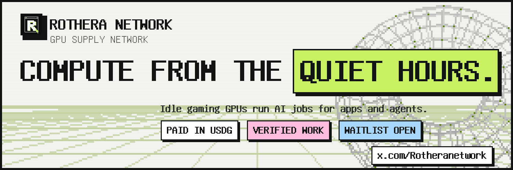
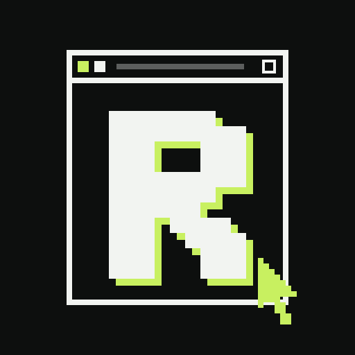

<p align="center">
  
</p>

<p align="center">
  
</p>

<h1 align="center">Rothera Network</h1>

<p align="center">
  <b>Compute from the quiet hours.</b><br>
  A GPU network on Robinhood Chain: idle gaming rigs run AI jobs and get paid in USDG.
</p>

<p align="center">
  <a href="rotheranetwork.xyz"><b>Website</b></a> ·
  <a href="https://x.com/Rotheranetwork">X / @Rotheranetwork</a> ·
  Ticker <b>$ROTHERA</b>
</p>

---

## What it is

Most gaming GPUs sit idle for most of the day. Rothera Network lets people rent that idle
time to apps and AI agents:

- **Nodes** install the client, set their hours and limits, and pick up jobs that fit their card.
- **Builders and agents** send one API request. Payment per call works through
  [x402](https://www.x402.org/) in [USDG](https://www.paxos.com/usdg).
- **Payment is held in escrow** and released only after the result passes verification.
- **Every epoch** publishes a receipt root on [Robinhood Chain](https://docs.robinhood.com/chain).

## Status

| Part | Status |
|---|---|
| Website and whitepaper v0.1 | Live |
| Docs | Preview |
| Node client, explorer, builder API | Before / at mainnet |

All figures on the site (prices, epoch length, bond size, payouts) are **examples** and may change.

## This repository

This repo holds the public website. It is a single static page with no build step.

```
index.html    the full site (HTML, CSS, JS in one file)
logo.png      logo
banner.png    banner
```

Run it locally by opening `index.html` in a browser, or:

```bash
python3 -m http.server 8000
# then visit http://localhost:8000
```

## Deploy (GitHub Pages)

1. Push this repo to GitHub.
2. Go to **Settings → Pages**.
3. Under **Source**, pick **Deploy from a branch**, branch `main`, folder `/ (root)`.
4. The site appears at https://rothera-network.github.io/rothera-network/

## Links

- X: https://x.com/Rotheranetwork
- Robinhood Chain: https://docs.robinhood.com/chain
- USDG: https://www.paxos.com/usdg
- x402: https://www.x402.org/

---

<sub>NVIDIA, AMD, USDG, Robinhood and x402 names and logos belong to their owners and are shown only to describe compatibility.</sub>
